# Introdução

Informações básicas do projeto.

* **Projeto:** Flamer
* **Repositório GitHub:** https://github.com/ICEI-PUC-Minas-PPLES-TI/plf-es-2026-1-ti1-7641100-flamer
* **Membros da equipe:**

  * João Pedro Teixeira Reis 
  * ️Bruno Calazans dos Reis
  * Pedro José de Magalhães Tavares Camilo️
  * Rodrigo Lage da Costa
  * Cairo Rodrigues Rezende
  * Ruan Pablo Silva Pinto

A documentação do projeto é estruturada da seguinte forma:

1. Introdução
2. Contexto
3. Product Discovery
4. Product Design (**A entrega da fase de Concepção finaliza aqui**)
5. Metodologia
6. Solução
7. Referências Bibliográficas

✅ [Documentação de Design Thinking (MIRO)](files/processo-dt.pdf)

# Contexto

Detalhes sobre o espaço de problema, os objetivos do projeto, sua justificativa e público-alvo.

## Problema

As queimadas representam um risco significativo para fazendeiros e pequenos produtores rurais, especialmente porque podem se alastrar rapidamente e causar prejuízos materiais, ambientais e produtivos. Em muitas propriedades, a detecção de focos de incêndio acontece de forma tardia, quando o fogo já está avançado e os danos se tornam mais difíceis de controlar. Além disso, pequenos produtores nem sempre possuem acesso fácil a sistemas de monitoramento, alertas em tempo real e orientações práticas para agir com rapidez diante de uma situação de risco.

Nesse contexto, o problema central está em como apoiar esses produtores no enfrentamento das queimadas de maneira mais eficiente, reduzindo perdas em áreas agrícolas, pastagens, maquinários, cercas e demais estruturas da propriedade. Também é necessário considerar a dificuldade de resposta rápida em regiões rurais mais afastadas, onde a comunicação pode ser limitada e o tempo de reação faz grande diferença no resultado final.

## Objetivos

O objetivo geral do projeto Flamer é desenvolver uma solução de software voltada para auxiliar fazendeiros e produtores rurais de pequeno porte na prevenção, no monitoramento e na resposta a queimadas, contribuindo para a redução de danos e prejuízos causados por esse tipo de ocorrência.

Como objetivos específicos, o projeto busca disponibilizar alertas que ajudem na identificação rápida de situações de risco, oferecer informações organizadas sobre possíveis focos de incêndio e criar uma experiência simples e acessível para usuários com diferentes níveis de familiaridade com tecnologia. Além disso, o Flamer pretende apoiar a tomada de decisão do produtor ao reunir dados e orientações que facilitem ações imediatas em momentos críticos.

## Justificativa

A escolha desse tema se justifica pela relevância das queimadas para o meio rural e pelos impactos que elas geram na vida de pequenos produtores. Quando um incêndio atinge uma propriedade, as consequências podem ir muito além da perda de produção, afetando a renda da família, a segurança das pessoas, os animais, a estrutura da fazenda e o equilíbrio ambiental da região.

O desenvolvimento do Flamer é importante porque busca atacar um problema real e recorrente, oferecendo uma solução digital que contribua para a prevenção e para a reação mais rápida diante das queimadas. A proposta do projeto também se mostra pertinente por focar em um público que muitas vezes possui menos acesso a ferramentas tecnológicas avançadas, tornando essencial a criação de uma interface intuitiva e de fácil uso.

Além disso, o tema permite explorar recursos tecnológicos com impacto social e ambiental positivo, aproximando o desenvolvimento de software de uma necessidade concreta do campo. Por isso, o projeto foi escolhido como uma forma de aplicar conhecimentos de desenvolvimento web em uma solução útil, prática e com potencial de gerar benefícios reais.

## Público-Alvo

O público-alvo do Flamer é composto principalmente por fazendeiros, pequenos produtores rurais e responsáveis por propriedades no campo que precisam acompanhar riscos de queimadas e agir com rapidez em situações de emergência. Em geral, trata-se de usuários que utilizam a tecnologia de forma funcional, muitas vezes por meio do celular, e que valorizam soluções simples, objetivas e confiáveis.

Esse público pode incluir pessoas com diferentes níveis de experiência digital, desde usuários mais familiarizados com aplicativos até aqueles que usam a tecnologia apenas para tarefas básicas. Por isso, a solução deve priorizar clareza, facilidade de navegação e informações diretas, evitando complexidade desnecessária.

Também podem ser considerados como usuários secundários funcionários da propriedade, gestores rurais e familiares envolvidos na rotina da fazenda, que podem precisar consultar alertas, registrar ocorrências ou acompanhar informações relevantes sobre riscos de incêndio. Dessa forma, o Flamer se direciona a um ambiente rural em que a agilidade na informação e a usabilidade da ferramenta são fatores essenciais.
# Product Discovery

## Etapa de Entendimento


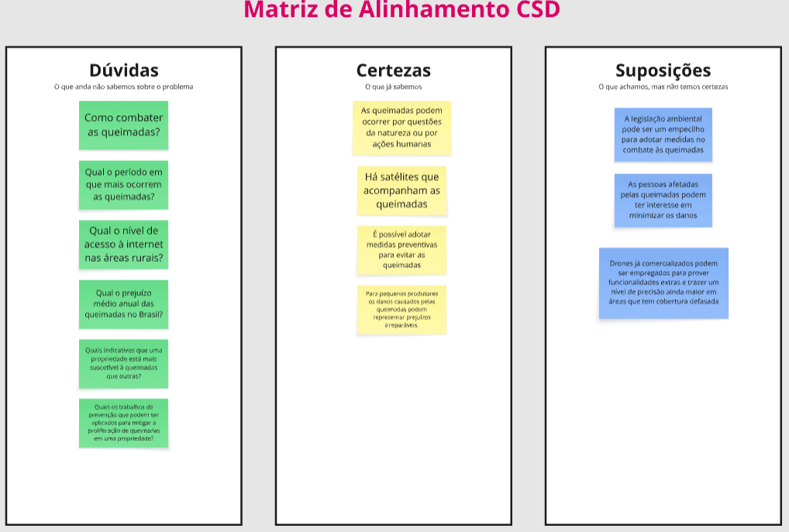

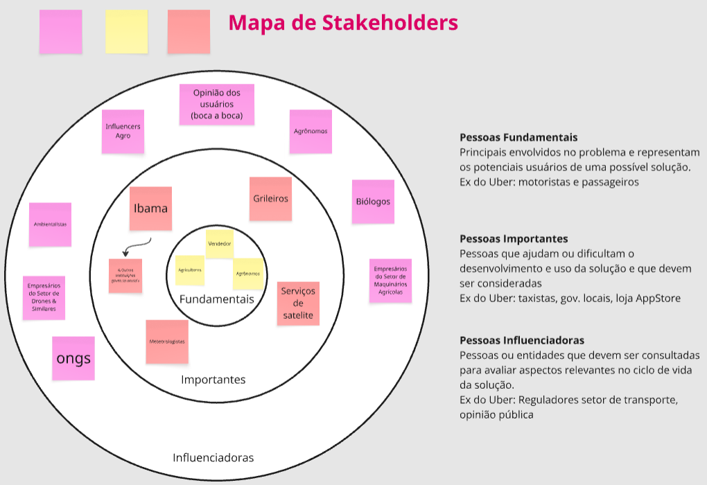

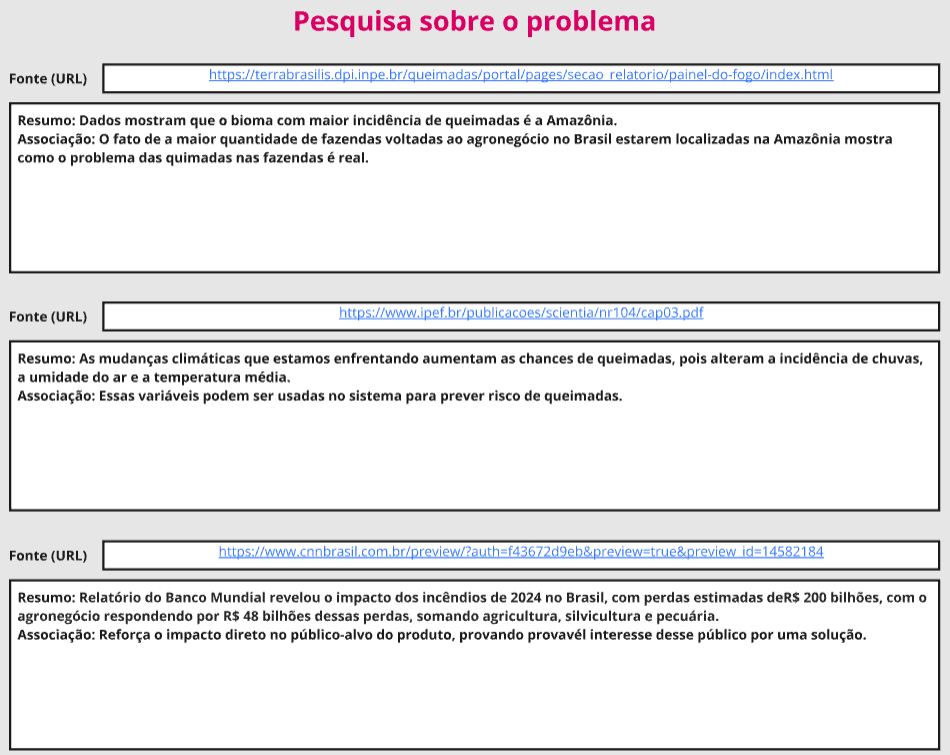

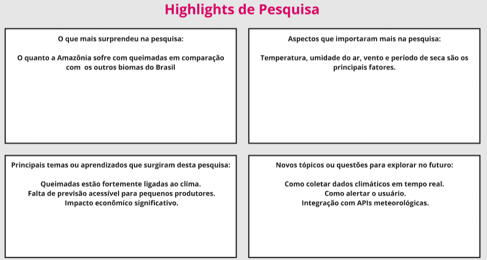


## Etapa de Definição

### Personas


Persona 1:

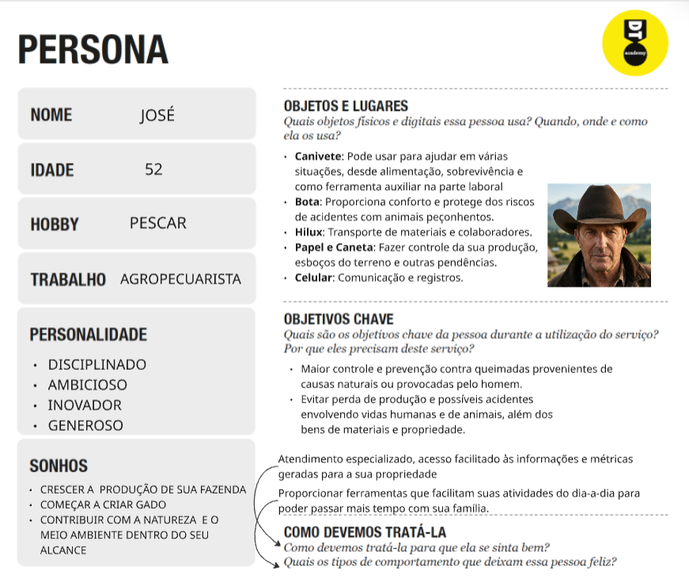

Persona 2:

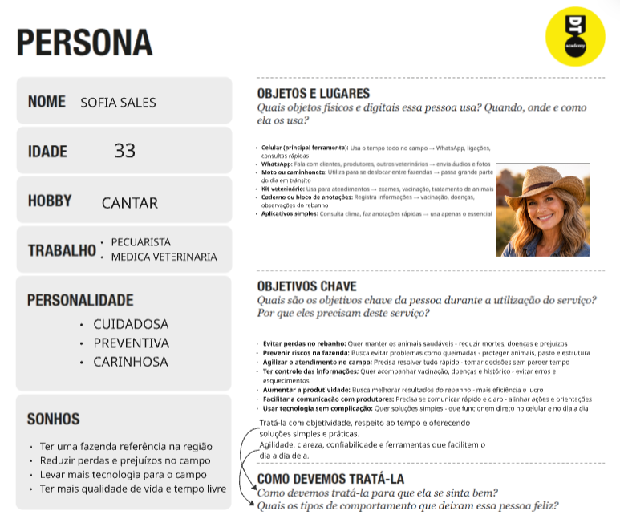

Persona 3:

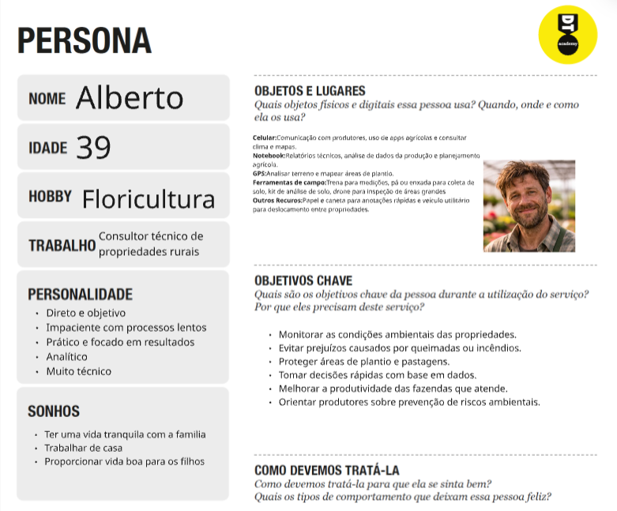

# Product Design

Nesse momento, vamos transformar os insights e validações obtidos em soluções tangíveis e utilizáveis. Essa fase envolve a definição de uma proposta de valor, detalhando a prioridade de cada ideia e a consequente criação de wireframes, mockups e protótipos de alta fidelidade, que detalham a interface e a experiência do usuário.

## Histórias de Usuários

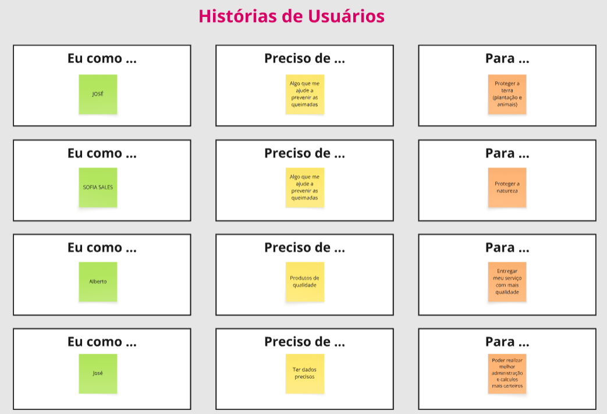

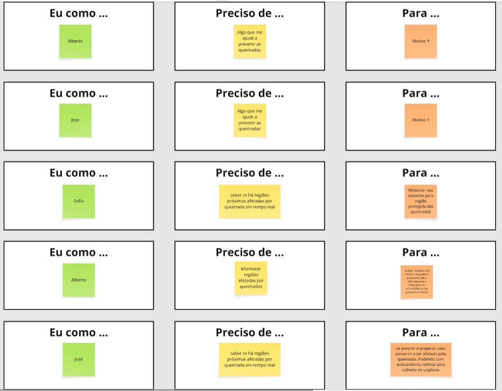
=======
| EU COMO...`PERSONA` | QUERO/PRECISO ...`FUNCIONALIDADE`        | PARA ...`MOTIVO/VALOR`               |
| --------------------- | ------------------------------------------ | -------------------------------------- |
| Usuário do sistema   | Algo que me ajude a prevenir as queimadas | Proteger a terra (plantação animal)             |
| Usuário do sistema         | Algo que me ajude a revenir as queimadas      | Proteger a natureza |
| Usuário do sistema         | Produtos de qualidade      | Entregar meu serviço com mais qualidade |
| Usuário do sistema         | Ter dados precisos      | Poder realizar melhor administração e calculos mais certeiros |
| Usuário do sistema         | Saber se há regiões próximas afetadas por queimadas em tempo real       | Mobilizar seu rebanho para região protegidas das queimadas |
| Usuário do sistema         | Monitorar regiões afetadas por queimadas      | analisar as áreas que foram impactadas e que podem afetar indiretamente a efetividade da polinização da sua produção de flores |
 Usuário do sistema         | saber se há regiões próximas afetadas por queimada em tempo real      | se previnir e preparar caso possa vir a ser afetado pela queimada. Podendo com antecedência realizar uma colheita de urgência |


## Proposta de Valor


Proposta de valor para Persona 1:

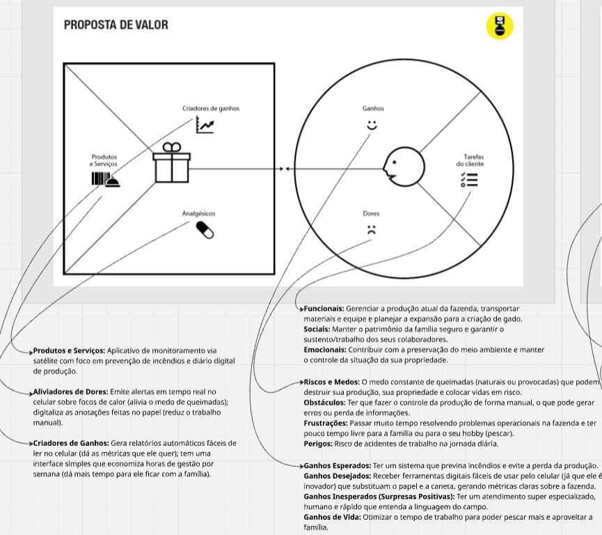

Proposta de valor para Persona 2:

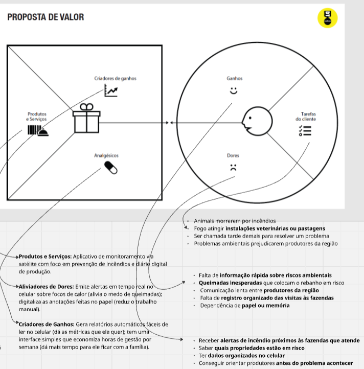

Proposta de valor para Persona 3

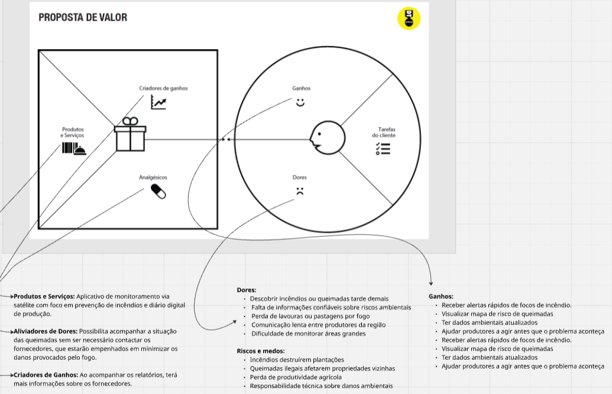


## Projeto de Interface

Artefatos relacionados com a interface e a interacão do usuário na proposta de solução.

### Wireframes

Estes são os protótipos de telas do sistema.

##### Wireframe DASHBOARD

O dashboard apresenta uma visão geral em tempo real da situação de risco de queimadas na propriedade do usuário. Nele, é possível visualizar alertas imediatos sobre focos próximos, incluindo distância e direção do vento, além de dados climáticos essenciais como temperatura, umidade, vento e índice de chuva.

Também há um mapa interativo destacando as regiões com maior incidência de queimadas, facilitando a análise visual do risco na área. Ao lado, o usuário acompanha a qualidade do ar atual, níveis de risco por região e uma lista de alertas ativos recentes, permitindo uma tomada de decisão rápida e preventiva.

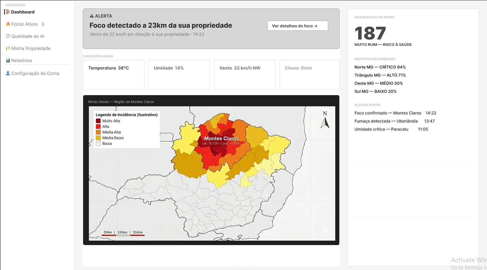

### User Flow

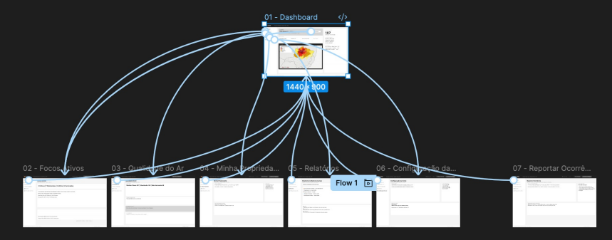

### Protótipo Interativo

✅ [Protótipo Interativo (Figma)](https://www.figma.com/proto/pVTZPOmI9OmqwkRH789bgu/Flamer-Wireframe-V1?node-id=7-2&t=4Ohl95vzZGRyCQKl-1&starting-point-node-id=8%3A363)
  
# Metodologia

Detalhes sobre a organização do grupo e o ferramental empregado.

## Ferramentas

Relação de ferramentas empregadas pelo grupo durante o projeto.

| Ambiente                    | Plataforma | Link de acesso                                     |
| --------------------------- | ---------- | -------------------------------------------------- |
| Processo de Design Thinking | Miro   | https://miro.com/app/board/uXjVID9zMPs=/ |
| Repositório de código       | GitHub | https://github.com/ICEI-PUC-Minas-PPLES-TI/plf-es-2026-1-ti1-7641100-flamer |
| Hospedagem do site          | — | — |
| Protótipo Interativo        | Figma  | https://www.figma.com/proto/pVTZPOmI9OmqwkRH789bgu/Flamer-Wireframe-V1 |
|                             |            |                                                    |


## Gerenciamento do Projeto

Divisão de papéis no grupo e apresentação da estrutura da ferramenta de controle de tarefas (Kanban).


# Solução Implementada

Esta seção apresenta todos os detalhes da solução criada no projeto.

## Vídeo do Projeto

O vídeo a seguir traz uma apresentação do problema que a equipe está tratando e a proposta de solução.

[](https://www.youtube.com/embed/70gGoFyGeqQ)


## Funcionalidades

Esta seção apresenta as funcionalidades da solução.Info

##### Funcionalidade - Home e Dashboard

Exibe o painel inicial com o mapa Leaflet dos focos de incêndio e propriedades do usuário, cards de estatísticas (focos ativos, qualidade do ar, alertas não lidos) e dados meteorológicos resumidos.

* **Estrutura de dados:** `focos_incendio`, `locais`, `alertas`, `qualidade_ar`, `meteorologia`
* **Instruções de acesso:** efetue login → página inicial (Home).

##### Funcionalidade - Focos Ativos

Lista e mapeia os focos de incêndio detectados por satélite próximos às propriedades do usuário, com filtro por intensidade e período.

* **Estrutura de dados:** `focos_incendio`, `locais`
* **Instruções de acesso:** efetue login → menu lateral → "Focos Ativos".

##### Funcionalidade - Reportar Ocorrência

Permite ao usuário criar, editar e excluir ocorrências de foco ou queimada, com tipo, severidade, descrição, coordenadas GPS e fotos.

* **Estrutura de dados:** `ocorrencias`
* **Instruções de acesso:** efetue login → menu lateral → "Reportar".

##### Funcionalidade - Qualidade do Ar

Exibe o Índice de Qualidade do Ar (IQA) por local, histórico e mapa de dispersão de fumaça.

* **Estrutura de dados:** `qualidade_ar`, `locais`
* **Instruções de acesso:** efetue login → menu lateral → "Qualidade do Ar".

##### Funcionalidade - Minha Propriedade

Gerencia as propriedades rurais do usuário logado: cadastro, edição de delimitação, status de risco, focos próximos e histórico de ocorrências.

* **Estrutura de dados:** `locais`, `focos_incendio`, `ocorrencias`, `alertas`, `meteorologia`
* **Instruções de acesso:** efetue login → menu lateral → "Minha Propriedade".

##### Funcionalidade - Relatórios

Gera e exporta relatórios mensais em PDF com resumo de focos, alertas e ocorrências da propriedade.

* **Estrutura de dados:** `relatorios`
* **Instruções de acesso:** efetue login → menu lateral → "Relatórios".

##### Funcionalidade - Histórico de Queimadas

Apresenta o histórico temporal de queimadas na região da propriedade, com filtros por período e intensidade.

* **Estrutura de dados:** `historico_queimadas`
* **Instruções de acesso:** efetue login → menu lateral → "Histórico".

##### Funcionalidade - Alertas e Notificações

Exibe alertas de risco (focos, qualidade do ar, meteorologia) do usuário, com opções de filtro, marcação como lido e configuração de canais de entrega.

* **Estrutura de dados:** `alertas`
* **Instruções de acesso:** efetue login → menu lateral → "Alertas".

##### Funcionalidade - Meteorologia

Apresenta dados meteorológicos em tempo real (temperatura, umidade, vento, chuva) para a região da propriedade do usuário.

* **Estrutura de dados:** `meteorologia`
* **Instruções de acesso:** efetue login → menu lateral → "Meteorologia".

##### Funcionalidade - Contatos de Emergência

Lista contatos de órgãos de emergência (Bombeiros, IBAMA, Defesa Civil, Polícia Ambiental) com telefones, e-mail e horários. Administradores podem adicionar e editar contatos.

* **Estrutura de dados:** `contatos_emergencia`
* **Instruções de acesso:** efetue login → menu lateral → "Contatos".

##### Funcionalidade - Configuração de Conta

Permite ao usuário visualizar e editar seus dados cadastrais, preferências de alerta e configurações da conta.

* **Estrutura de dados:** `usuarios`, `config_conta`
* **Instruções de acesso:** efetue login → menu lateral → "Conta".

## Estruturas de Dados

Descrição das estruturas de dados utilizadas na solução com exemplos no formato JSON.Info

##### Estrutura de Dados - Usuários

Registro de usuários do sistema, utilizados para autenticação e perfil.

```json
{
  "id": "2",
  "nome": "Bruno Calazans",
  "email": "brunocalazansreis@gmail.com",
  "senha": "123456",
  "tipo": "usuario"
}
```

##### Estrutura de Dados - Locais (Propriedades)

Propriedades rurais cadastradas pelos usuários, com coordenadas geográficas e nível de risco.

```json
{
  "id": "1",
  "nome": "Fazenda do Bruno",
  "cidade": "Uberlândia",
  "estado": "MG",
  "lat": -18.9186,
  "lng": -48.2772,
  "tamanho": "450 hectares",
  "risco": "alto",
  "usuarioId": 2
}
```

##### Estrutura de Dados - Focos de Incêndio

Focos de calor detectados por satélite, vinculados às propriedades.

```json
{
  "id": "1",
  "localId": 1,
  "lat": -18.9200,
  "lng": -48.2800,
  "intensidade": "alta",
  "satelite": "GOES-16",
  "data": "2026-05-21"
}
```

##### Estrutura de Dados - Alertas

Alertas de risco emitidos para o usuário (focos, qualidade do ar, meteorologia).

```json
{
  "id": "F-0234",
  "categoria": "foco",
  "tipo": "critical",
  "titulo": "Foco Crítico",
  "descricao": "Foco F-0234 detectado a 2.3 km da Fazenda São Bento.",
  "severidade": "Crítico",
  "horario": "2026-05-21T14:12:00",
  "lido": false
}
```

##### Estrutura de Dados - Ocorrências

Registros de ocorrências reportadas pelos usuários.

```json
{
  "id": "1",
  "tipo": "Incêndio",
  "descricao": "Fogo na borda da fazenda perto do rio",
  "localId": 1,
  "usuarioId": 2,
  "data": "2026-05-17",
  "status": "resolvido"
}
```

##### Estrutura de Dados - Contatos de Emergência

Contatos de órgãos de emergência disponíveis na plataforma.

```json
{
  "id": "1",
  "nome": "Bombeiros",
  "telefone": "193",
  "tipo": "bombeiro"
}
```

##### Estrutura de Dados - Meteorologia

Dados meteorológicos por propriedade, utilizados nos módulos de Meteorologia e Dashboard.

```json
{
  "id": "1",
  "localId": 1,
  "temperatura": 32,
  "umidade": 28,
  "vento": "22 km/h NE",
  "data": "2026-05-21"
}
```

## Módulos e APIs

Esta seção apresenta os módulos e APIs utilizados na solução

**Backend:**

* Node.js + Express — servidor HTTP
* JSON Server 0.17.4 — API REST com `db.json` como banco de dados em arquivo

**Mapas:**

* Leaflet 1.9.4 — [https://leafletjs.com/](https://leafletjs.com/)
* OpenStreetMap — tiles de mapa base
* Nominatim — geocodificação reversa

**APIs externas:**

* Open-Meteo — [https://open-meteo.com/](https://open-meteo.com/) — dados meteorológicos gratuitos

**Fontes:**

* DM Sans e DM Mono — Google Fonts — [https://fonts.google.com/](https://fonts.google.com/)

**UI (tela de login):**

* Bootstrap 5.3.3 — [https://getbootstrap.com/](https://getbootstrap.com/)

# Referências

As referências utilizadas no trabalho foram:

* Leaflet.js. **Leaflet — an open-source JavaScript library for mobile-friendly interactive maps**. Disponível em: https://leafletjs.com/. Acesso em: 2026.
* Open-Meteo. **Free Weather API**. Disponível em: https://open-meteo.com/. Acesso em: 2026.
* OpenStreetMap contributors. **OpenStreetMap**. Disponível em: https://www.openstreetmap.org/. Acesso em: 2026.
* JSON Server. **json-server — Get a full fake REST API with zero coding**. Disponível em: https://github.com/typicode/json-server. Acesso em: 2026.
* Bootstrap. **Bootstrap — The most popular HTML, CSS, and JS library in the world**. Disponível em: https://getbootstrap.com/. Acesso em: 2026.
* INPE. **Monitoramento de Queimadas e Incêndios**. Disponível em: https://queimadas.dgi.inpe.br/. Acesso em: 2026.
